# Safe Zones Mockup

**Check whether your vertical videos and images survive the social media interface before you publish them.**

Safe Zones Mockup is a single, self-contained HTML file. You drop an image or a video onto it and see your piece inside a phone, with the interface of the chosen social network drawn on top (buttons, captions, profile, navigation bar) and the risk areas highlighted in red. You can switch between Instagram Reels, Instagram Stories, Instagram Feed 4:5, TikTok, YouTube Shorts and Facebook Reels with one click, or see all six side by side.

It was built for directors, motion designers, editors and art directors who need a quick, reliable answer to one question: **is anything important hidden by the app's UI?** That means the headline, the logo, the product, the CTA, the legal text or the subtitles.

- No installation, no account, no server. Everything runs in your browser.
- **Your files never leave your device.** Images and videos are opened locally with the browser's File API and are never uploaded anywhere.
- Works on desktop (Chrome, Safari, Firefox, Edge), iPad and phones.

**Live version:** https://frankiedl.github.io/safe-zones-mockup/ (served by GitHub Pages from this repository)

> The interface of the tool is currently in Spanish. This README explains every control in English, with the Spanish label in brackets, so you can use it without speaking Spanish.

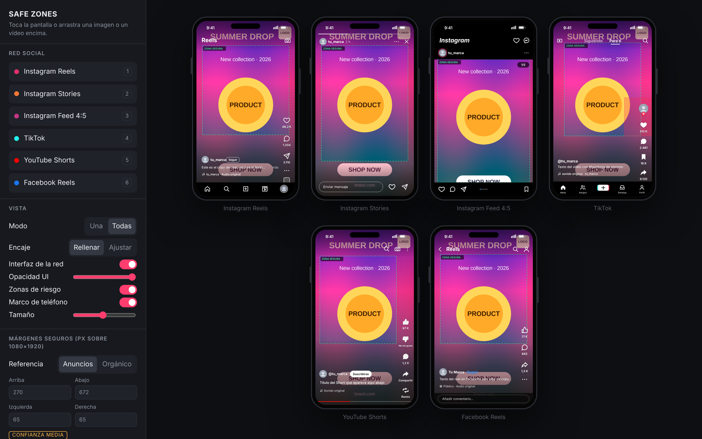

---

## Table of contents

1. [Why this exists](#why-this-exists)
2. [Quick start](#quick-start)
3. [Screenshots](#screenshots)
4. [Supported platforms](#supported-platforms)
5. [How to read the overlay](#how-to-read-the-overlay)
6. [Controls, one by one](#controls-one-by-one)
7. [Ads vs organic reference](#ads-vs-organic-reference)
8. [Safe zone values and sources](#safe-zone-values-and-sources)
9. [Using a real screenshot of the app](#using-a-real-screenshot-of-the-app)
10. [Exporting a frame for clients](#exporting-a-frame-for-clients)
11. [Working with video](#working-with-video)
12. [Using it on iPhone, iPad and Android](#using-it-on-iphone-ipad-and-android)
13. [Keyboard shortcuts](#keyboard-shortcuts)
14. [Recommended workflow](#recommended-workflow)
15. [Limitations and honest caveats](#limitations-and-honest-caveats)
16. [Hosting it yourself](#hosting-it-yourself)
17. [How it works under the hood](#how-it-works-under-the-hood)
18. [Customising the platforms](#customising-the-platforms)
19. [Privacy](#privacy)
20. [License](#license)

---

## Why this exists

Every vertical platform covers part of the frame with its own interface. On a Reel, the bottom third holds the caption, the username, the audio line and, in ads, the call-to-action button. The right side holds the like, comment, share and save buttons. The top holds the tab bar or the progress bars of a Story. Each platform does it differently, and the layouts change from one app version to the next.

The usual ways to check this are slow or unreliable:

- Exporting, uploading to a test account and checking on a phone takes minutes per iteration.
- Static PNG templates have to be placed by hand in After Effects, Premiere or Photoshop, one per platform.
- Online checkers usually cover a single platform, require an account, upload your files to their servers, or don't say where their numbers come from.

Safe Zones Mockup gives you the check in seconds, for six placements at once, without uploading anything. It also tells you **how much you can trust each number**, because most published "safe zone" values are approximations and the tool says so instead of pretending otherwise.

---

## Quick start

1. Open the [live version](https://frankiedl.github.io/safe-zones-mockup/), or download [`index.html`](index.html) and double-click it.
2. Drag an image or a video onto the window. On a phone or tablet, tap the phone screen or the **"Toca o arrastra aquí tu imagen o vídeo"** button to pick a file from your photo library.
3. Pick a network in the left panel (or the top strip on a phone).
4. Look at the green dashed rectangle (**safe zone**) and the red tinted areas (**risk areas**). Anything important that falls in the red is likely to be covered by the interface.
5. Switch to **"Todas"** to see all platforms at once, and use **"Exportar PNG del fotograma"** to save a frame with the overlay for your client or team.

You can try it straight away with the sample images in [`examples/`](examples/). They were made on purpose with a headline, a logo and a CTA placed in typical danger areas.

---

## Screenshots

### Desktop

| Instagram Reels | TikTok (ads reference) |
|---|---|
| 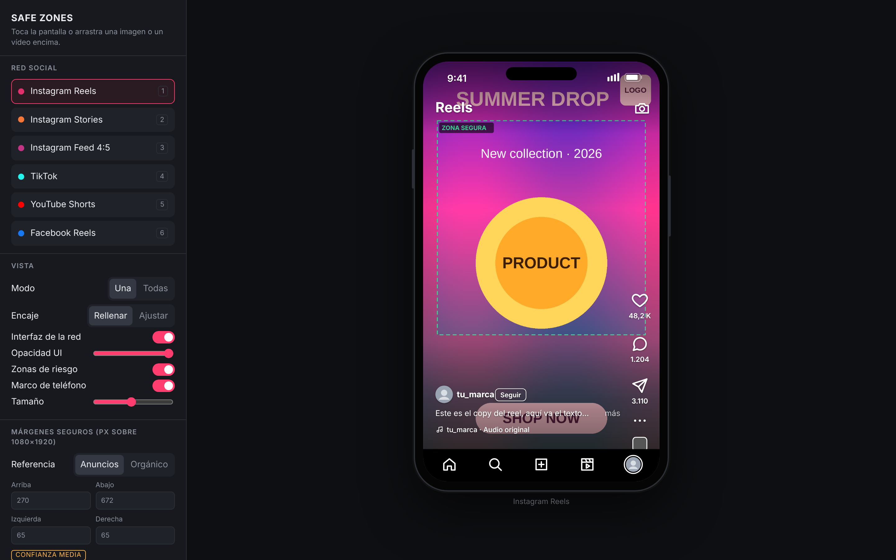 | 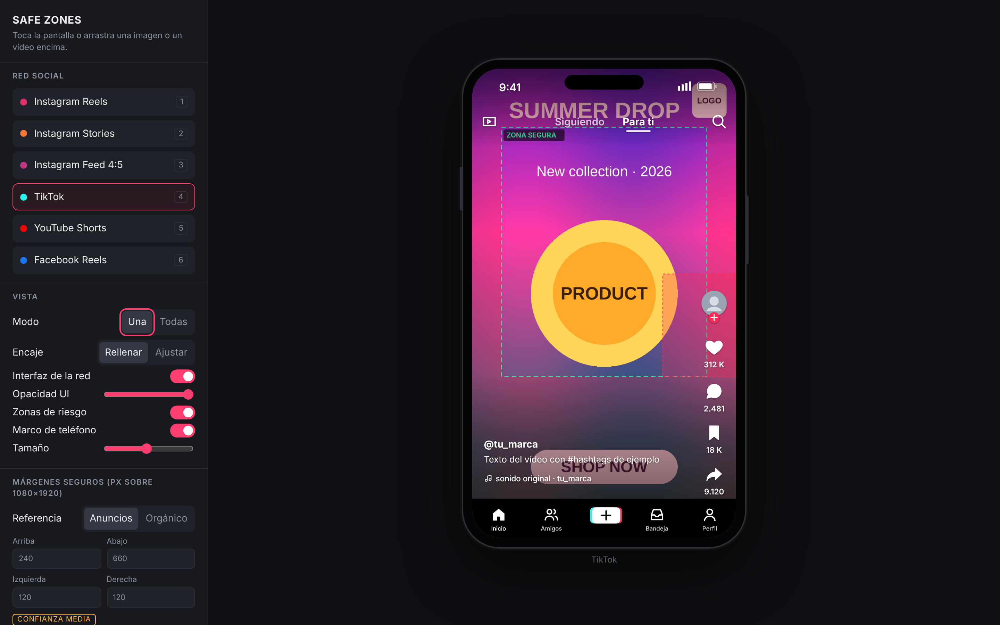 |

| YouTube Shorts (ads reference) | YouTube Shorts (organic reference) |
|---|---|
| 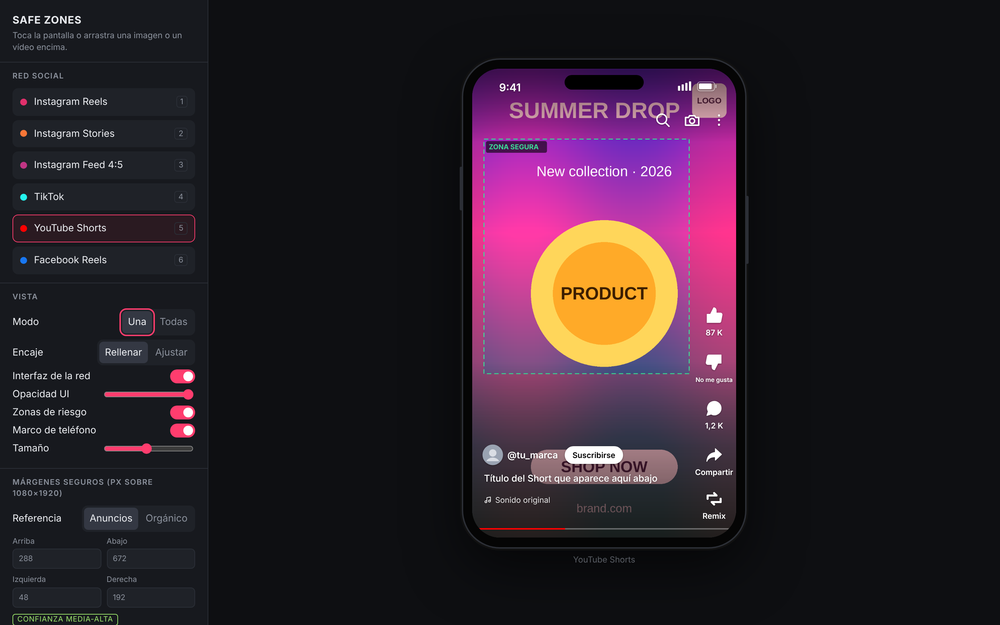 | 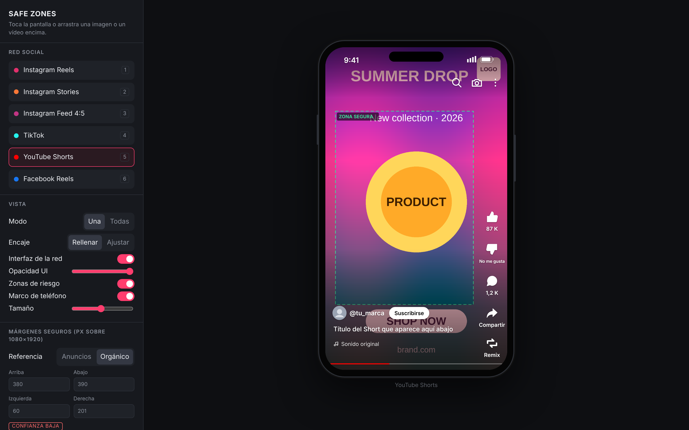 |

| Instagram Stories | Facebook Reels |
|---|---|
| 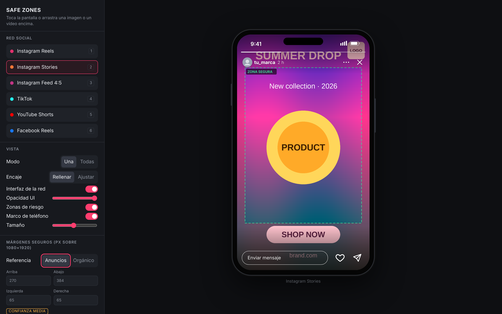 | 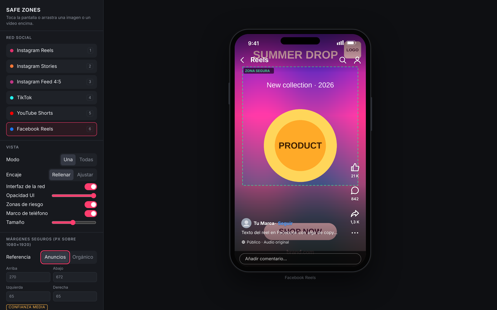 |

| Instagram Feed 4:5 | Safe zones only (UI hidden) |
|---|---|
| 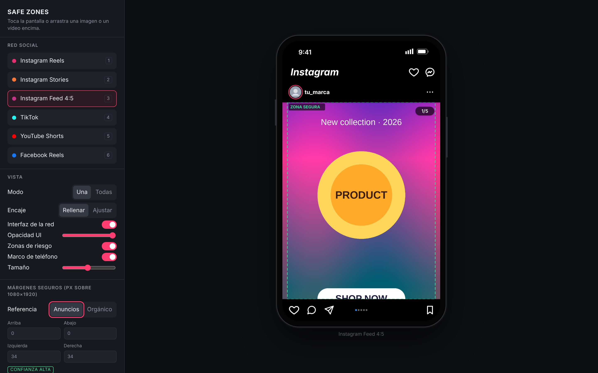 | 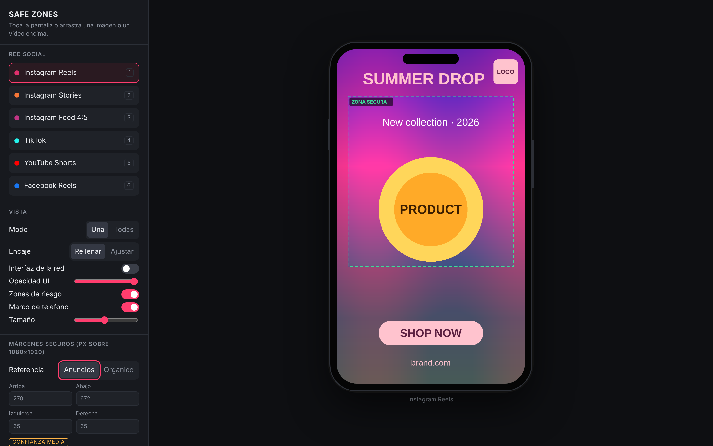 |

| UI only (safe zones hidden) | Export dialog |
|---|---|
| 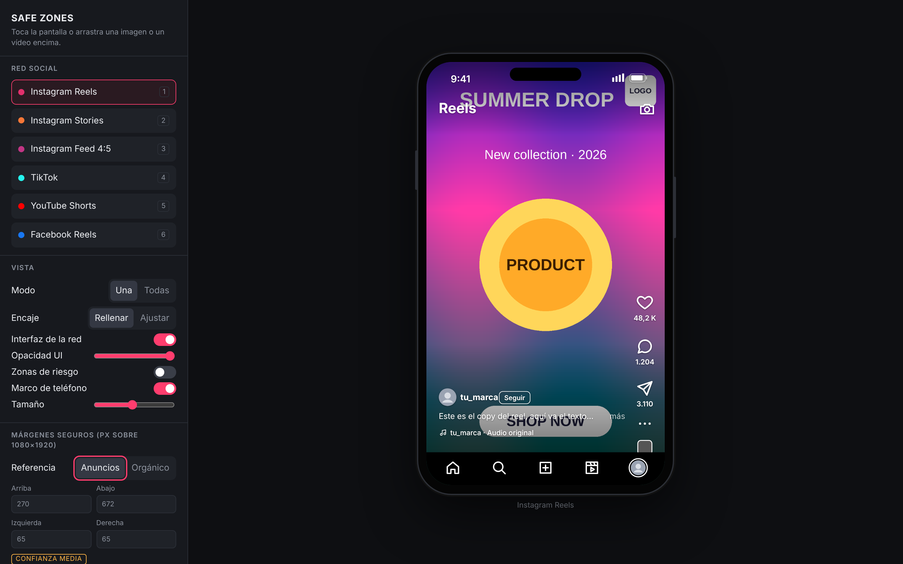 | 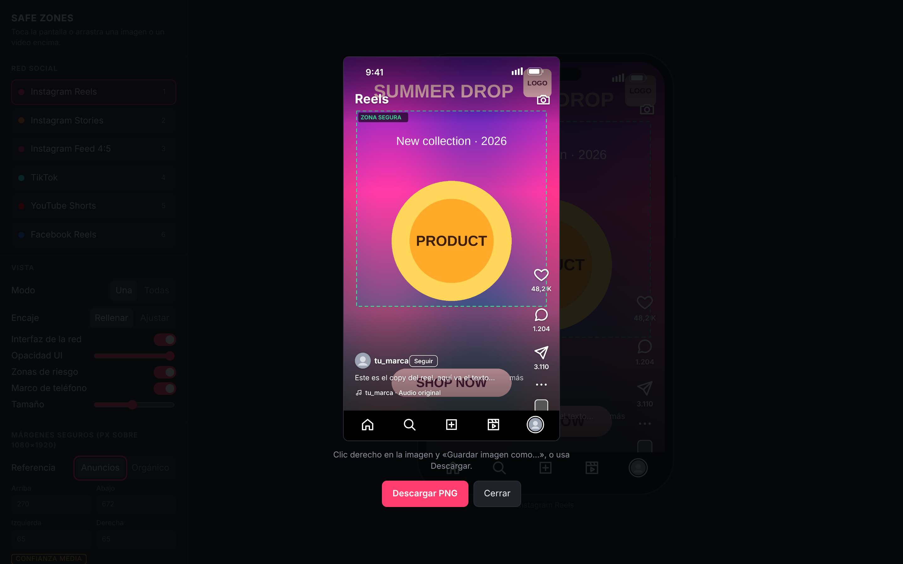 |

### iPad and iPhone

| iPad | iPhone | iPhone, TikTok | iPhone, all platforms |
|---|---|---|---|
| 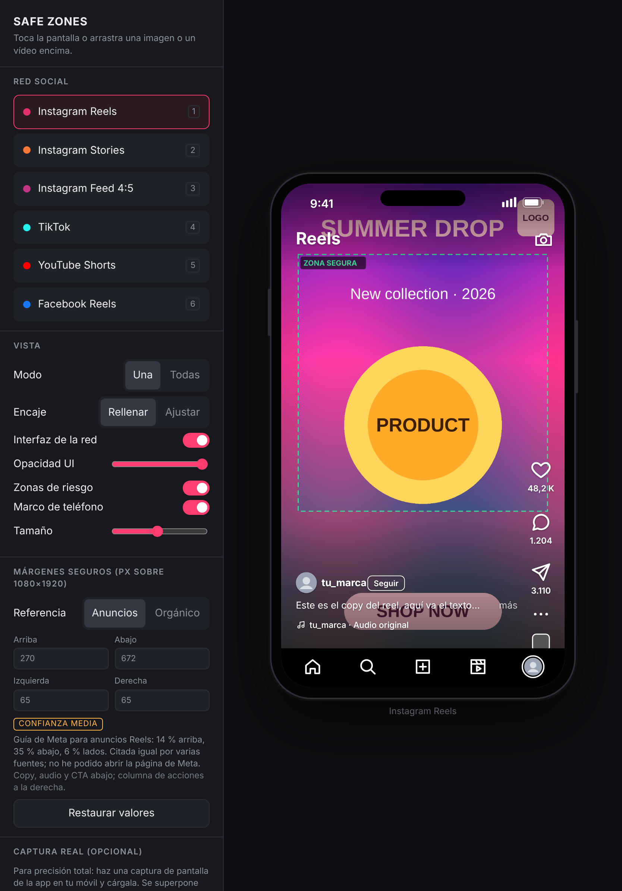 | 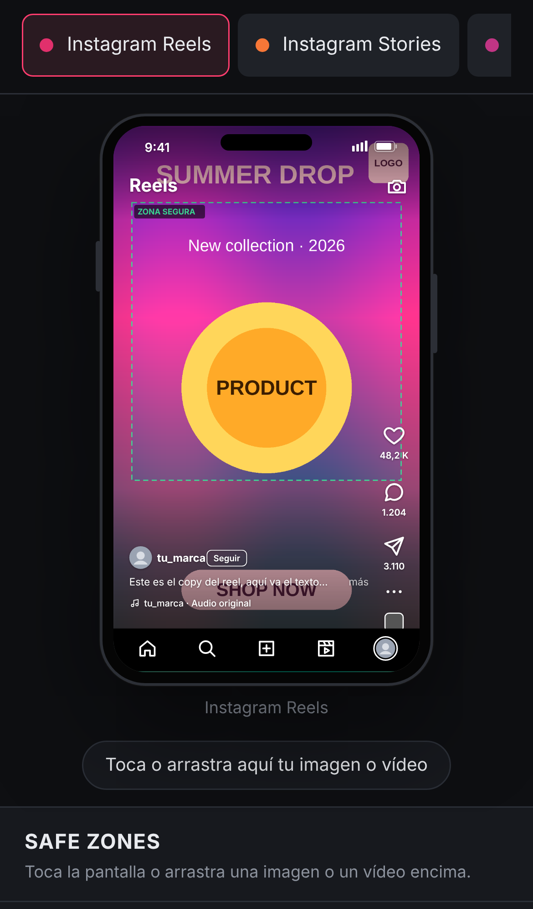 | 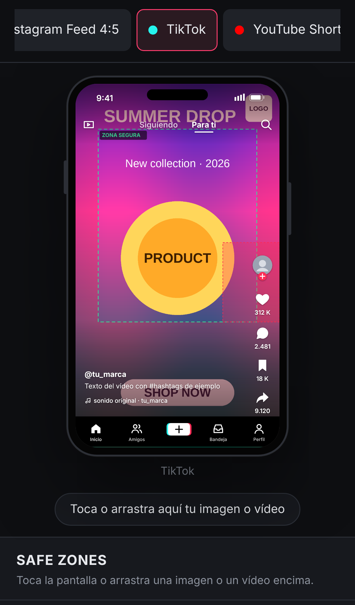 | 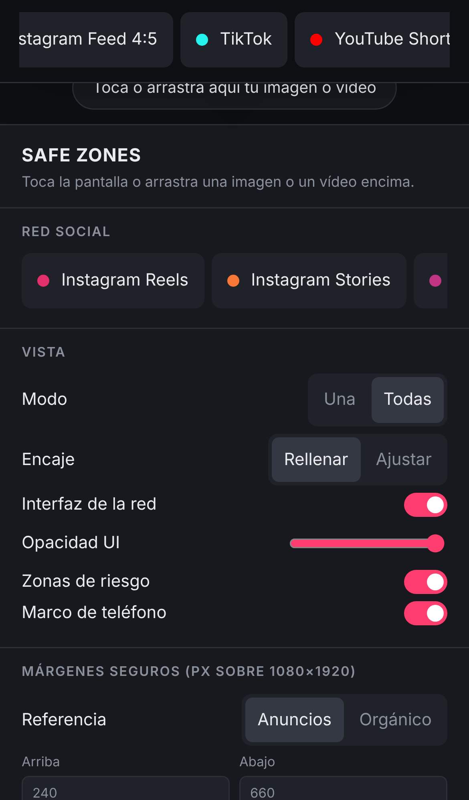 |

### Exported frame

This is the 1080×1920 PNG the tool produces: your frame, the interface and the safe zone, ready to send.

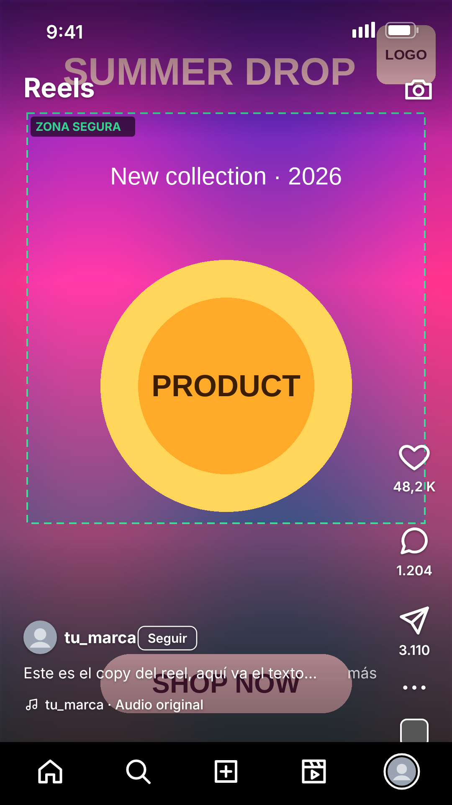

---

## Supported platforms

| # | Platform | Canvas | What the overlay simulates |
|---|---|---|---|
| 1 | **Instagram Reels** | 1080×1920 (9:16) | "Reels" header and camera icon, right-hand action column (like, comment, share, more, audio thumbnail), username with Follow button, caption, audio line, bottom navigation bar |
| 2 | **Instagram Stories** | 1080×1920 (9:16) | Progress bars, avatar, username, time, more and close buttons, "Send message" field with like and share |
| 3 | **Instagram Feed 4:5** | Post of 1080×1350 inside the feed | App header, post header (avatar, username), carousel counter, action row, carousel dots. The interface sits around the post, not on top of it |
| 4 | **TikTok** | 1080×1920 (9:16) | LIVE icon, Following / For You tabs, search, avatar with follow badge, like, comment, save and share column, username, caption, sound line, bottom navigation with the + button |
| 5 | **YouTube Shorts** | 1080×1920 (9:16) | Search, camera and menu icons, like, dislike, comment, share and remix column, channel avatar, name and Subscribe button, title, sound line, progress bar |
| 6 | **Facebook Reels** | 1080×1920 (9:16) | Back arrow, "Reels" title, search and profile icons, like, comment, share and more column, page name with Follow, caption, audience and audio line, comment field |

All coordinates are expressed on a **1080×1920 reference canvas**, which is the standard delivery size for vertical video on every one of these platforms. If your file has a different resolution but the same 9:16 ratio (for example 720×1280 or 2160×3840), it is scaled and the safe zones still apply proportionally.

---

## How to read the overlay

- **Green dashed rectangle ("ZONA SEGURA")**: the area where key content should live. Text, logos, product shots, faces and CTAs placed here should stay visible.
- **Red tinted area**: everything outside the safe zone. It may be covered by the interface, cropped on some screens, or both. Background, texture and non-essential image can live here; essential information should not.
- **Extra red rectangle with a dashed red border**: an additional exclusion area that does not fit a simple four-margin model. Today this is used for the **TikTok action column** in ads mode, which takes the right side from y = 840 down.
- **The drawn interface** (icons, captions, counters) shows where things typically sit, so you can judge what really overlaps. The safe zone and the drawn interface are separate layers and can be toggled independently.

A practical rule: if a piece of information would be a problem if a viewer did not see it, it belongs inside the green rectangle on every platform you are delivering to. **"All" view ("Todas")** is the fastest way to find the intersection.

---

## Controls, one by one

Spanish label in brackets.

### Social network (Red social)
Buttons for the six platforms. The number on the right is its keyboard shortcut. On a phone this becomes a horizontal strip pinned to the top of the screen; swipe it sideways to see every platform.

### View (Vista)
- **Mode (Modo)**: **One (Una)** shows a single phone. **All (Todas)** shows all six platforms at once with the same file. In "All" view, click any phone to open it on its own. Videos play in sync across all phones.
- **Fit (Encaje)**: **Fill (Rellenar)** scales the media to cover the whole screen and crops what does not fit, which is what the apps do. **Fit (Ajustar)** shows the whole file with bars, which is useful to see what is being cropped.
- **Network interface (Interfaz de la red)**: shows or hides the drawn app interface. Shortcut `U`.
- **UI opacity (Opacidad UI)**: fades the interface so you can see your content underneath it.
- **Risk zones (Zonas de riesgo)**: shows or hides the safe zone rectangle and red areas. Shortcut `S`.
- **Phone frame (Marco de teléfono)**: shows or hides the phone body around the screen. Turn it off for a flat, edge-to-edge view.
- **Size (Tamaño)**: size of the phone on desktop. On phones and tablets the size adapts automatically to the screen and orientation.

### Safe margins (Márgenes seguros, px over 1080×1920)
- **Reference (Referencia)**: **Ads (Anuncios)** or **Organic (Orgánico)**. See [Ads vs organic reference](#ads-vs-organic-reference).
- **Top, Bottom, Left, Right (Arriba, Abajo, Izquierda, Derecha)**: the four margins, in pixels, on the 1080×1920 canvas. You can edit them. Your edits are remembered in your browser, separately for each platform and each reference mode, and are marked as **"Editado por ti"** (edited by you).
- **Confidence badge (Confianza alta / media-alta / media / baja)**: how reliable the default values are. Below it, a short text explains where the values come from.
- **Restore values (Restaurar valores)**: puts back the default values for the current platform and mode.

### Real screenshot (Captura real, optional)
- **Load screenshot for this network (Cargar captura para esta red)**: lets you load a real screenshot of the app as the overlay. See [Using a real screenshot of the app](#using-a-real-screenshot-of-the-app).
- **Remove screenshot (Quitar captura)**.
- **Screenshot opacity (Opacidad captura)**.

### File (Archivo)
- **File information**: name, type, resolution and duration. The tool warns you if the aspect ratio does not match what the platform expects (9:16 or 4:5), explains whether that means cropping or bars, and warns you if the width is below 1080 px.
- **Open file (Abrir archivo…)**: file picker. On iOS and Android it opens the photo library or the Files app.
- **Export frame PNG (Exportar PNG del fotograma)**: see [Exporting a frame for clients](#exporting-a-frame-for-clients).

### Video bar
Appears when a video is loaded: play / pause, previous frame, next frame, a scrub bar and the timecode.

---

## Ads vs organic reference

The platforms publish safe zone guidance **for advertising**, because ads add a call-to-action button and sponsor labels on top of the normal interface. For **organic** posts, none of them publishes official numbers. That is why the tool has two modes:

- **Ads (Anuncios)** uses the values from each platform's ad guidelines or official templates. These are the most defensible numbers and are usually more conservative, especially at the bottom of the frame.
- **Organic (Orgánico)** uses measurements of the app interface. Some come from third parties who measured the app and some are my own estimates. They are less conservative and have lower confidence.

If you are not sure, **design for the ads values**. Anything that is safe for ads is safe for organic. The opposite is not always true.

---

## Safe zone values and sources

All values are in pixels on a 1080×1920 canvas, written as **top / bottom / left / right**. They were reviewed in October 2026. Full notes are in [`docs/SOURCES.md`](docs/SOURCES.md).

### Ads reference

| Platform | Default values | Where they come from | Confidence |
|---|---|---|---|
| Instagram Reels | 270 / 672 / 65 / 65 | Meta's guidance for Reels ads: keep 14 % at the top, 35 % at the bottom and 6 % on each side free of text and logos. Cited consistently by several independent guides. Meta's own help page blocks automated reading, so I could not quote it directly. | Medium |
| Instagram Stories | 270 / 384 / 65 / 65 | Meta's guidance for Stories: 14 % top, 20 % bottom, 6 % sides. Some 2026 guides claim Meta merged Stories and Reels into a single safe zone (35 % bottom), but none of them cites a Meta announcement, so it is not applied by default. If you want to be extra safe, set the bottom margin to 672. | Medium |
| Instagram Feed 4:5 | 0 / 0 / 34 / 34 (inside the post) | In the feed, the interface sits around the post and does not cover it. The side margins show the **3:4 crop that the profile grid applies** to a 4:5 post (1012×1350), calculated geometrically. | High |
| TikTok In-Feed | 240 / 660 / 120 / 120, plus the action column from x = 780 to 1080, y = 840 downwards | TikTok Ads In-Feed template, annotated at 720×1280 and scaled ×1.5. Reported by a third party that cites the official template at ads.tiktok.com. I could not open the template file myself. Other values that circulate online (150/440/60, 220/480/250) appear to be outdated. | Medium |
| YouTube Shorts | 288 / 672 / 48 / 192 | Google's "Universal safe zones for video ads on YouTube" (vertical template). Google publishes these values only inside a diagram image. Two independent sites that measured the official template agree on these exact numbers. | Medium-high |
| Facebook Reels | 270 / 672 / 65 / 65 | Meta applies the same Reels guidance to Facebook and Instagram. | Medium |

### Organic reference

| Platform | Default values | Where they come from | Confidence |
|---|---|---|---|
| Instagram Reels | 280 / 440 / 60 / 170 | Estimate, measured on the interface | Low |
| Instagram Stories | 270 / 384 / 65 / 65 | Same as ads. Meta does not publish a separate organic guide | Medium |
| Instagram Feed 4:5 | 0 / 0 / 34 / 34 | Profile grid crop, calculated | High |
| TikTok | 200 / 334 / 86 / 140 | In-app measurement published by a third party. TikTok publishes no organic values | Low |
| YouTube Shorts | 380 / 390 / 60 / 201 | In-app measurement published by a third party. YouTube publishes no organic values | Low |
| Facebook Reels | 280 / 500 / 60 / 170 | Estimate, measured on the interface | Low |

### Why not "100 % accurate"?

Because no such number exists. The real interface depends on the app version, the phone model and screen ratio (19.5:9 phones crop a 9:16 video differently from 16:9 ones), the language (captions wrap differently), the length of the caption and the username, whether the post is an ad, and A/B tests that the platforms run constantly. The published values are guidelines with a margin built in. This tool shows them transparently and lets you adjust them, instead of claiming a precision nobody can guarantee.

---

## Using a real screenshot of the app

The drawn interface is a **generic recreation**. Positions are close to the real apps, but the icons are not the official ones and the layout is not pixel-perfect. When you need certainty:

1. On your phone, open the app and the exact placement you are delivering to (a Reel, a Story, a TikTok, a Short), ideally on a post with a dark or plain background.
2. Take a screenshot.
3. In the tool, select that platform and use **"Cargar captura para esta red…"** (Load screenshot for this network).
4. The screenshot is stretched over the 9:16 screen and replaces the drawn interface for that platform. Adjust **"Opacidad captura"** (Screenshot opacity) to see your content through it.

Tips:

- Screenshots are kept per platform for the current session, so you can load one for each network and use the "All" view.
- Modern phones are taller than 9:16 (around 19.5:9). The app shows a 9:16 video cropped or letterboxed, so a full-screen screenshot will not line up exactly with a 1080×1920 canvas. For best results, crop the screenshot to the area where the video is displayed before loading it.
- The safe zone layer stays visible on top of your screenshot, so you can compare the official guidance with the real interface.

---

## Exporting a frame for clients

**"Exportar PNG del fotograma"** creates a 1080×1920 PNG with:

- the current frame of your video (or your image), with the same fit mode you are using,
- the screenshot overlay, if you loaded one,
- the drawn interface and the safe zone, if they are switched on.

The exported image opens in a dialog:

- **On desktop**: click **"Descargar PNG"** (Download PNG), or right-click the image and choose "Save image as…".
- **On iPhone and iPad**: press and hold the image and choose **"Save to Photos"** or **"Save Image"**.
- **On Android**: press and hold the image and choose "Download image".

The file name includes the original file name, the platform and, for videos, the timecode, for example `spot_v3_igreels_12-40s.png`.

---

## Working with video

- **Formats**: anything your browser can play. MP4 (H.264) works everywhere. WebM works in Chrome, Edge, Firefox and recent Safari. HEVC/H.265 works in Safari and on most Macs. **ProRes .mov files do not play in browsers**; export a lightweight H.264 proxy for review.
- **Size**: the file is played locally, so large files are fine as long as your device can decode them. Very large 4K files may stutter on phones; a 1080p proxy is enough for a safe zone check.
- **Scrubbing**: drag the scrub bar, or use the `←` and `→` keys (or the ‹ › buttons) to step one frame at a time. Frame stepping assumes 30 fps.
- **Sync**: in "All" view, every phone plays the same video and stays in sync, so you can scrub once and check six placements.
- **Audio**: videos are muted on purpose so they can autoplay on every device.

---

## Using it on iPhone, iPad and Android

The page adapts to the screen:

- **Phones**: the phone mockup fills the width, the platform selector is a strip pinned to the top, and all settings sit below the preview. The video bar stays pinned to the bottom of the screen.
- **iPad and tablets**: in landscape, and in portrait on most iPads, you get the desktop layout with the side panel. On small tablets in portrait you get the phone layout.
- **Loading files**: tap the phone screen or the load button. iOS and Android open the photo library or the Files app. Drag and drop also works on iPad with Split View or Stage Manager.
- **Saving exports**: press and hold the exported image (see above).
- **Home screen**: in Safari, use Share → Add to Home Screen to open it like an app.

Tested in emulation on iPhone SE, iPhone 14, Pixel 7, iPad Pro 11 (portrait and landscape) and desktop, with no horizontal scrolling or layout errors. Please open an issue if something looks wrong on a real device.

---

## Keyboard shortcuts

| Key | Action |
|---|---|
| `1` to `6` | Switch platform (Reels, Stories, Feed, TikTok, Shorts, Facebook Reels) |
| `U` | Show or hide the network interface |
| `S` | Show or hide the safe zones |
| `Space` | Play or pause the video |
| `←` / `→` | Previous or next frame |

---

## Recommended workflow

1. **Before the shoot or the animation**: export an empty frame with the safe zones of every placement you deliver to (load any 9:16 image, choose "All", export each platform) and use it as a framing guide in the viewfinder, the storyboard or the comp.
2. **During editing or animation**: drop rough exports in the tool to check supers, end cards, product shots and subtitles.
3. **Before delivery**: check the final master in "All" view, scrub through the key moments, and export a frame per platform for the client.
4. **When the client asks "will this be covered?"**: send the exported PNG. It shows the frame, the interface and the official safe zone in one image, and the confidence badge tells you how firm the guidance is.

---

## Limitations and honest caveats

- The **drawn interface is a generic recreation**, not the official one. Use the real screenshot option when it matters.
- **Safe zone values are guidelines**, not guarantees. The confidence badge and [`docs/SOURCES.md`](docs/SOURCES.md) explain each one.
- The phone screen is drawn at **exactly 9:16**, matching the 1080×1920 delivery canvas. Real phones are taller and may crop slightly more at the top and bottom, or show the video with bars.
- **Ads add elements** that are not drawn: sponsored labels, CTA buttons, product tags and shopping stickers. The ads margins account for them, but they are not drawn.
- The interface text is placeholder text in Spanish (`tu_marca`, `Seguir`, etc.). Real captions and usernames vary in length.
- Only vertical placements and the 4:5 feed are covered. Horizontal YouTube, LinkedIn, Pinterest, Snapchat and X are not included yet.
- Screenshots you load are kept only in memory and disappear when you reload the page. Margin edits are kept in your browser's local storage.

---

## Hosting it yourself

The whole tool is one file, [`index.html`](index.html), with no dependencies and no external requests.

- **Locally**: download `index.html` and open it in a browser. It works offline.
- **GitHub Pages**: fork this repository, go to *Settings → Pages*, choose *Deploy from a branch*, select `main` and `/ (root)`, and save. Your copy will be available at `https://<your-user>.github.io/safe-zones-mockup/`.
- **Any static host**: upload `index.html` to Netlify, Vercel, S3, your own server or a shared folder on your network.

---

## How it works under the hood

- **One HTML file**: HTML, CSS and vanilla JavaScript, no frameworks, no build step, no external fonts or libraries.
- **Local files**: images and videos are opened with `URL.createObjectURL()`, so they play directly from your disk.
- **Overlays**: each platform's interface is generated as an SVG on a fixed `viewBox="0 0 1080 1920"`, so every coordinate in the code is a real pixel on the delivery canvas. The safe zone is drawn in the same SVG, as an even-odd path (red area) and a dashed rectangle (green outline).
- **Export**: the current video frame or image is drawn to a 1080×1920 `<canvas>` with the same fit logic as the preview. Then the overlay SVG is rasterised on top and the result is encoded as PNG.
- **Sync**: in "All" view, the first video is the master clock and the others are nudged to its time when they drift by more than 80 ms.
- **Storage**: the selected platform, the reference mode, the phone size and your edited margins are stored in `localStorage`. Every access is wrapped in `try/catch`, so the tool still works in private windows or when storage is blocked.
- **Responsive layout**: CSS media queries switch between a side panel layout (above 760 px) and a stacked phone layout. The phone size is calculated from the available width and height and recalculated on resize and on orientation change. Touch devices get larger hit areas (`pointer: coarse`), and videos use `playsinline` so iOS does not force fullscreen.

---

## Customising the platforms

Every platform is one object in the `PLATFORMS` array in `index.html`:

```js
{ id:'tiktok', name:'TikTok', color:'#25f4ee',
  media:[0,0,1080,1920],            // where the content sits on the 1080×1920 screen
  ratio:9/16,                        // expected aspect ratio of the file
  safe:{ ads:{t:240,b:660,l:120,r:120}, org:{t:200,b:334,l:86,r:140} },
  extra:{ ads:[[780,840,1080,1920]] },   // extra exclusion boxes [x1,y1,x2,y2]
  src:{ ads:['Where the values come from','media'], org:['…','baja'] },
  note:'Short description of the layout',
  ui(){ return /* SVG markup of the interface */ }
}
```

To add a new platform, copy one of the objects, change the `id`, `name`, margins and sources, and draw its interface in `ui()` with the helpers already in the file: `ic()` for icons, `tx()` for text, `avatar()`, `pill()`, `statusBar()` and `rightCol()`. To change a default value permanently, edit `safe`. To change it only for yourself, edit the margins in the panel.

Pull requests with updated values are very welcome, as long as they include a source.

---

## Privacy

Safe Zones Mockup does not upload, store or send your files anywhere. It has no analytics, no cookies and no external requests. Everything happens inside your browser tab. The only thing it remembers between visits is your preferences (platform, reference mode, phone size and custom margins), stored in your own browser.

---

## License

[MIT](LICENSE). Use it, change it and share it, including in commercial work.

Instagram, Facebook, TikTok and YouTube are trademarks of their respective owners. This project is not affiliated with, endorsed by or sponsored by Meta, ByteDance or Google. The interface overlays are simplified generic recreations made for layout checking only.
